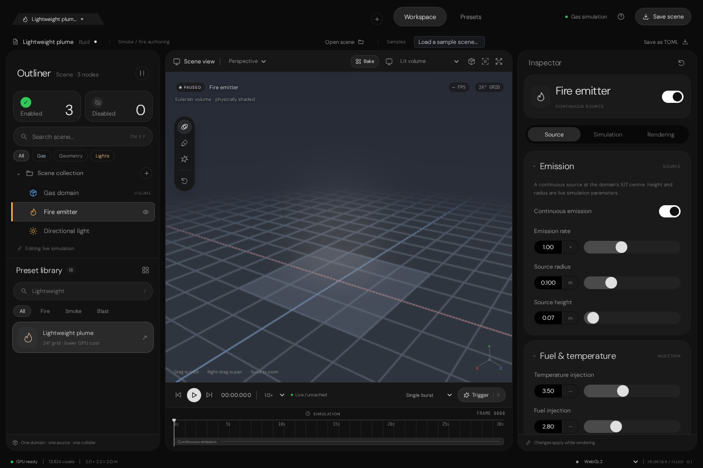

# Fluid Editor source restoration evidence

## Outcome

Copied the existing non-node gas Fluid Editor from the latest inspected branch into `Experimental/Fluid/`; no replacement UI was authored.
The restored prototype exposes plume, detonation/blast, wildfire tornado, and dust tornado presets, source/solver/render controls,
eight TOML sample scenes, and WebGL2 with experimental WebGPU selection.

Source provenance is documented in `Experimental/Fluid/README.md`:

- `SultanAladin/Frontier-`, branch `arena/b5d061d9-frontier`
- copied branch tip `7ff19ee57e11d649aff94d8f0195a4333cfe1a88` (2026-10-14)
- Fluid sample-scene update `f1dfdcf998dfc2831d3ff84bead659a85ddf7f1f`

The Remastered Particle Studio was moved from `Experimental Remastered/EditorInterface/` to
`Experimental Remastered/ParticleEditor/`. Its path links, suite links, and redirect were updated. The separate older
`Experimental/ParticleEditor/` tree was retained because the reference validators and exporter still consume it.

## Verification

| Check | Result |
|---|---|
| Dependency install | `npm ci --no-audit --no-fund` succeeded; Node.js 22.22.3, npm 10.9.8 |
| Production bundle | `npm run build` succeeded with Vite 7.3.6; DM Sans assets bundle from the existing licensed Particle Studio fonts |
| Scene/preset/codec suite | `npm test`: 22 passed, 0 failed |
| Browser/render suite | `npm run verify:browser`: 18 passed, 0 failed |
| Interaction suite | `npm run verify:interactions`: 9 passed, 0 failed |
| Moved and Fluid entry routes | 7 static HTTP routes returned 200 |
| Captured browser image | `Images/Verification-2026-11-09/VerifiedWorkspace.png` |

The browser suites exercised live WebGL2 simulation/rendering, software SwiftShader readback, settings edits, preset loading,
TOML import/export, responsive layout, source/collider manipulation, explosions, camera controls, overlays, and lifecycle behavior.
No browser JavaScript or WebGL errors were recorded.

## Reproduction

From the repository root:

```bash
cd Experimental/Fluid
npm ci --no-audit --no-fund
npm run build
npm test
npm run dev -- --host 0.0.0.0
```

For the retained browser proof, Chromium 153 was installed in ignored scratch with `@sparticuz/chromium@153.0.0`; its bundled
Amazon Linux libraries were exposed through `LD_LIBRARY_PATH`:

```bash
LD_LIBRARY_PATH=/tmp/al2023/lib \
BROWSER_EXECUTABLE=/tmp/chromium \
BROWSER_ARTIFACTS=/home/user/Frontier/Exhibits/FluidEditor/Images/Verification-2026-11-09 \
npm run verify:browser

LD_LIBRARY_PATH=/tmp/al2023/lib \
BROWSER_EXECUTABLE=/tmp/chromium \
npm run verify:interactions
```

A small Python `ThreadingHTTPServer` served the repository root for the seven static-route checks. The application preview itself
is Vite on `0.0.0.0:5173`.

## Evidence image



## Multi-view render proofs — 2026-11-09

Four images crop the actual Fluid viewport in perspective, front, side, and top camera presets; the fifth is the full 1920×1080 editor window. All four crops use the same settled lightweight-plume preset (`low_gpu_performance`): 24³ grid, 54 solver steps, 1.504 s simulated time, then paused for consistent angles. They were captured from the browser editor's WebGL2 renderer on SwiftShader; readback reported no GL error or lost context.

| Region | Evidence |
|---|---|
| Perspective viewport | [`01-PerspectiveViewport.png`](./Images/RenderProofs-2026-11-09/01-PerspectiveViewport.png) |
| Front viewport | [`02-FrontViewport.png`](./Images/RenderProofs-2026-11-09/02-FrontViewport.png) |
| Side viewport | [`03-SideViewport.png`](./Images/RenderProofs-2026-11-09/03-SideViewport.png) |
| Top viewport | [`04-TopViewport.png`](./Images/RenderProofs-2026-11-09/04-TopViewport.png) |
| Full workspace window | [`05-WorkspaceWindow.png`](./Images/RenderProofs-2026-11-09/05-WorkspaceWindow.png) |

These are browser-prototype render proofs, not evidence that the separate native C++ Fluid UI launches or controls `FluidSimulationSequence`; that integration remains out of scope here.

## Native C++ GPU simulation (2026-11-09)

A separate native Fluid execution path now lives in `Frontier/Engine/Rendering/FluidSimulation/` and uses Slang compute shaders
under `Frontier/Engine/Shaders/FluidSimulation/`. The GPU sequence keeps velocity, smoke, vapor, temperature, divergence, and
pressure in Vulkan 3D textures. Its dispatch sequence applies queued radial sources and the native level `IFieldSampler`, performs
semi-Lagrangian advection and stable scalar diffusion, solves pressure with Jacobi iterations, and projects velocity. The native
ForceField is sampled at Fluid cell centres on the host only to upload its field as a GPU input texture; Fluid state evolution is
performed by `.slang` compute. `FluidSpace` retains the authored source queue and an initial/latest-readback cell snapshot; GPU
readback is explicit and does not run a CPU simulation step. Fluid burst events collected from that readback still route through
`ParticleTriggerRouter::DispatchFluidBurst` into `ParticleSpace`.

`FluidSimulationGpuValidation` ran on the pinned SwiftShader Vulkan device and passed: source transport, native ForceField coupling,
GPU pressure projection, explicit readback, volume preview, disabled-sampler fallback, and burst routing. RMS divergence changed
from `0.424441` to `0.357503` for the validation field. Seven Fluid SPIR-V entries are stored in
`EngineContent/ShaderArchives/FluidSimulation/` and verified against their `.slang` sources. SwiftShader is a software Vulkan
device; physical hardware GPU execution has not been tested. `FluidSpaceValidation` separately covers the `.fluidspace` codec,
queued inputs, a direct world-space ForceField sample used by Particle coupling, and Fluid-to-Particle burst routing.

With CMake, the targeted reproduction is:

```bash
cmake --build build/forcefield-workspace --target FluidSimulationGpuValidation
ctest --test-dir build/forcefield-workspace -R '^(FluidSpaceValidation|FluidSimulationGpuValidation)$' --output-on-failure
python Automation/StoreShaderArchives.py --verify --sets FluidSimulation
```

The CTest sets the pinned SwiftShader Vulkan loader and ICD when the restored runtime exists under
`ExternalPackages/VulkanCompute/SwiftShader/`.

The existing Fluid browser app and C++ native sequence are **not connected**. The browser verification above covers its own WebGL2
prototype only, and the existing native Fluid UI shell still does not launch or control `FluidSimulationSequence`. Do not interpret
the GPU validation as evidence of live Fluid editor UI integration.

## Limits

- This is browser prototype execution, not native C++ editor UI. The browser simulation/rendering remains separate from the native GPU sequence.
- Software SwiftShader WebGL is the browser test renderer; its optional WebGPU selection falls back to WebGL2. The native C++ compute test uses the pinned SwiftShader Vulkan device.
- Windows/MSVC and native hardware GPU execution were not run.
- The screenshot shows the actual browser rendering at the end of the verification interactions; it is not a mockup or a native editor capture.
